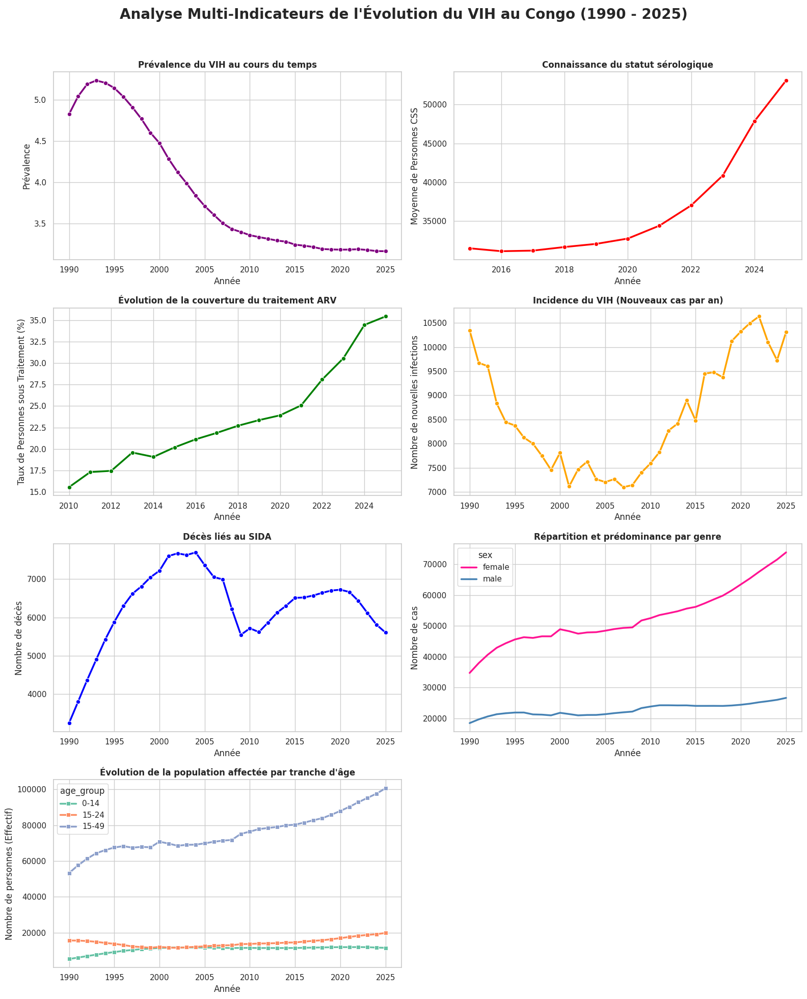

# Évolution du VIH en République du Congo (1990–2025)

**Akieni Academy · Formation Data Science · Semaine 16 · Groupe 8**

Analyse exploratoire des données sur le VIH en République du Congo : évolution de l’épidémie, accès au diagnostic et au traitement, différences selon le sexe et l’âge, recommandations et limites.

## Objectifs et indicateurs

Le projet étudie sept indicateurs :

- **Prévalence** du VIH en pourcentage.
- **Connaissance du statut sérologique**, en nombre de personnes.
- **Couverture ARV**, parmi toutes les personnes vivant avec le VIH.
- **Nouvelles infections** annuelles.
- **Décès liés au sida** annuels.
- **Répartition par sexe**.
- **Répartition par âge** : 0–14, 15–24 et 15–49 ans.

## Données et méthode

Le fichier nettoyé contient **1 380 lignes et 12 colonnes**. Ses métadonnées mentionnent l’ONUSIDA et l’OMS ; les sept séries visualisées utilisent les données étiquetées **ONUSIDA**.

La démarche comprend le filtrage sur le Congo, le nettoyage, la sélection des indicateurs, le contrôle d’unicité des observations et la visualisation. Les calculs évitent de mélanger les unités ou d’additionner les totaux et leurs sous-groupes.

## Structure du dépôt

```text
Project_hiv_Congo_Evolution/
├── README.md
├── LICENSE
├── Dataset/
│   └── Donnees_congo.csv
├── Documents/
│   ├── GROUPE 8 PLAN.pdf
│   ├── Rapport_J2.pdf
│   ├── Rapport_jour3.pdf
├── Scripts/
│   ├── EVAL_GP8.ipynb
│   └── eval_gp8.py
├── Rapport D'analyse des données de VIH 1990-2025.docx
└── resultats.png
```

## Résultats et documentation



- **[Rapport d’analyse actualisé — Word](Rapport%20D%27analyse%20des%20donn%C3%A9es%20de%20VIH%201990-2025.docx)** : résultats, recommandations et limites.
- [Plan du groupe](Documents/GROUPE%208%20PLAN.pdf).
- Rapports d’avancement : [Jour 2](Documents/Rapport_J2.pdf) et [Jour 3](Documents/Rapport_jour3.pdf).
- [Notebook](Scripts/EVAL_GP8.ipynb) et [script Python](Scripts/eval_gp8.py).

Les rapports journaliers retracent les étapes du travail ; certaines méthodes initiales du Jour 3 ont été révisées dans le code actuel.

## Utilisation

Ouvrir le notebook avec **Jupyter** ou **Google Colab**. Dépendances :

```bash
pip install pandas numpy seaborn matplotlib
```

Le fichier brut `hiv_global_timeseries.csv`, appelé au début du notebook, n’est pas inclus. Pour utiliser le CSV nettoyé, exécuter les imports puis charger :

```python
# Depuis la racine du dépôt
hiv_cog = pd.read_csv("Dataset/Donnees_congo.csv")
hiv_cog["year"] = hiv_cog["year"].astype(int)
```

Depuis `Scripts/`, utiliser `../Dataset/Donnees_congo.csv`. Exécuter ensuite les blocs **calcul des indicateurs** et **visualisation**, sans relancer le chargement ni le nettoyage du fichier brut.

## Limites et précautions

- La suppression de la charge virale n’est pas disponible : la cascade **95-95-95** n’est pas entièrement évaluée.
- Le diagnostic est présenté en effectif ; la couverture ARV globale n’est pas le deuxième 95.
- Les séries de diagnostic et de traitement ne couvrent pas toute la période.
- Les 15–24 ans sont inclus dans les 15–49 ans : **ne pas additionner ces groupes**. Les adolescents de 10–19 ans ne sont pas isolés.
- Cette analyse décrit des tendances, sans démontrer les causes ni l’efficacité des politiques publiques.

## Membres du Groupe 8

- **MALONGA MBOUITY Giversy Deliche** — Lead
- **M’PIKA Emmanuelle**
- **M’BIELO-LIBEAU Davis Junior**
- **MARIMPORI MANDAKA Edouarda**
- **AZIDAMA Belvine**
